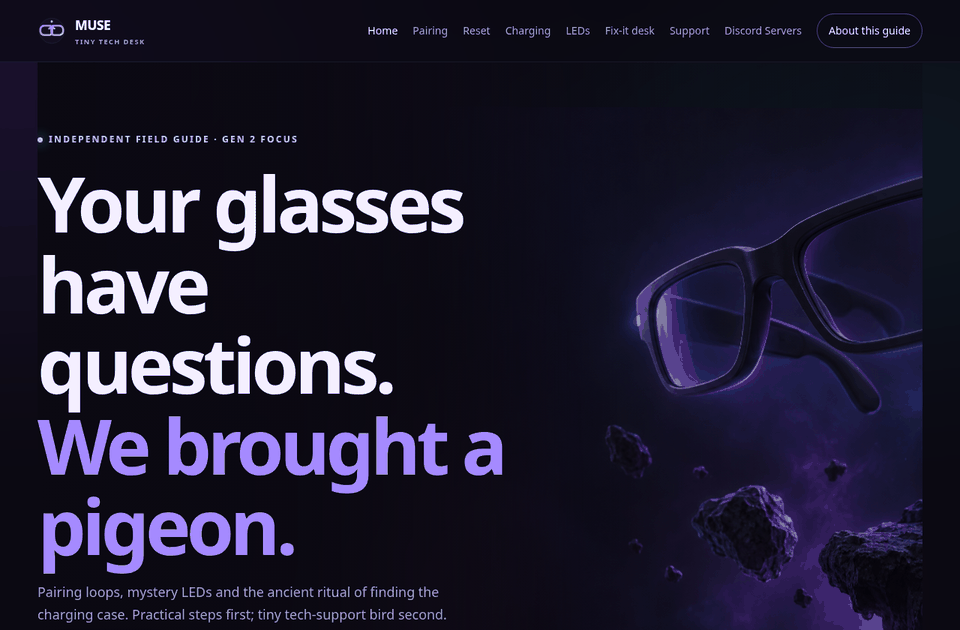
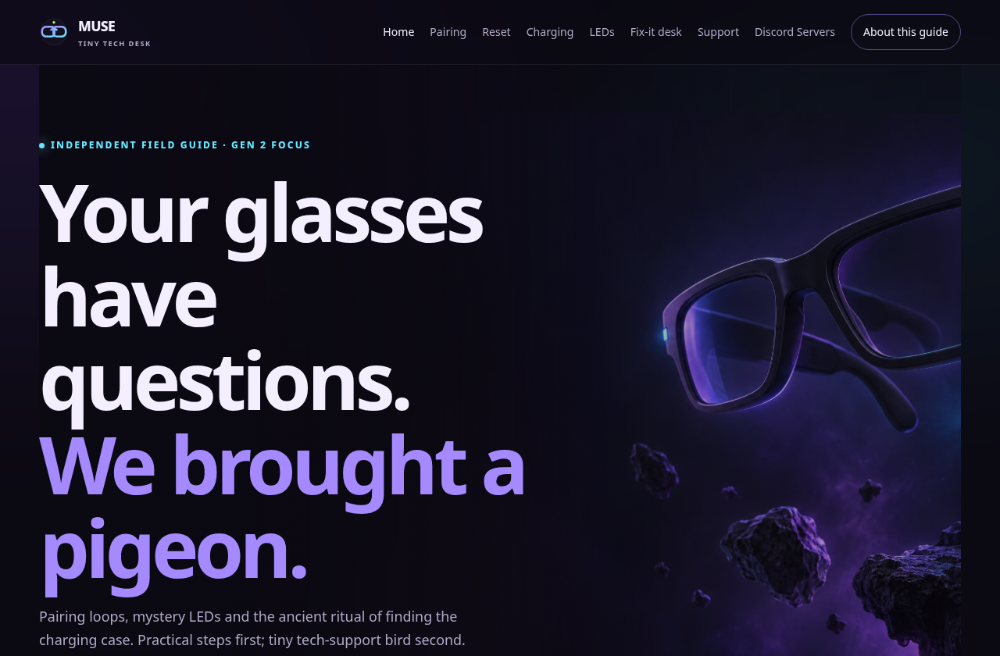
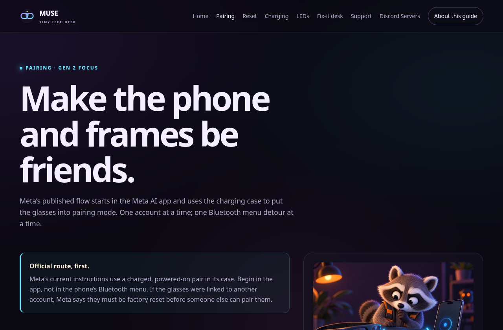
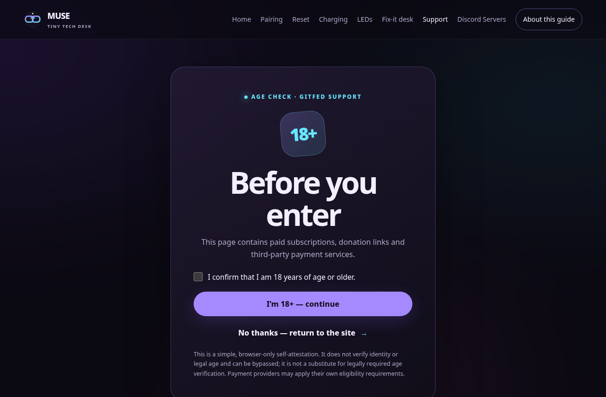
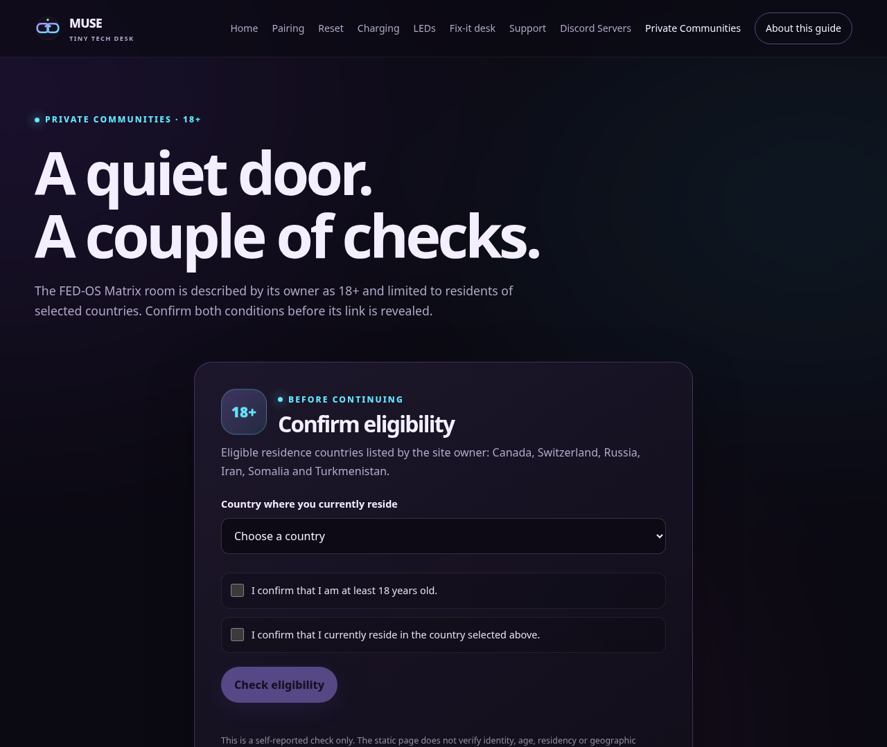
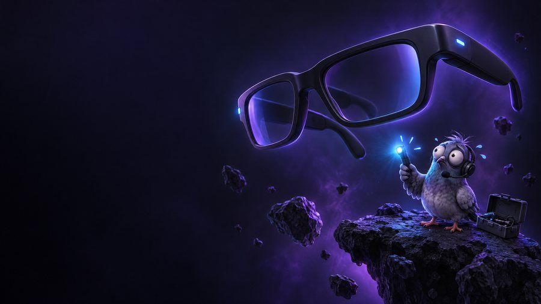
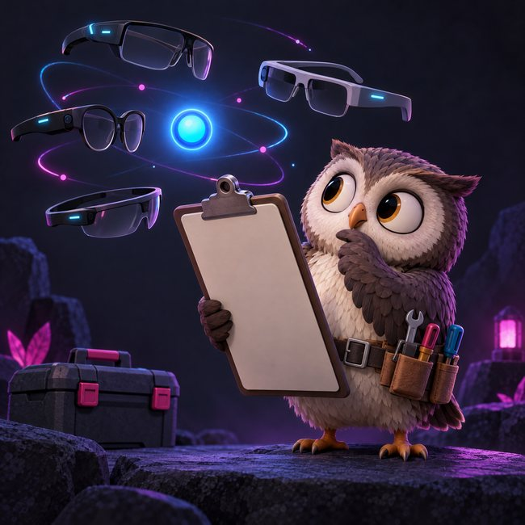

# Muse AI Glasses

An unofficial, no-build field guide for pairing, charging, resetting, and troubleshooting Ray-Ban Meta smart glasses.

> Independent fan-made reference. Not affiliated with or endorsed by Meta, Ray-Ban, or EssilorLuxottica.

## Why this exists

Smart-glasses setup can become a scavenger hunt through phone settings, app screens, blinking lights, and reset rituals. The risky part is that the most tempting “fix” may erase captures or send someone toward an unsupported charging method.

Muse turns the common jobs into small, direct HTML guides. It puts the manufacturer’s published route first, labels unverified field notes as unverified, and makes the destructive steps impossible to miss. The tone is playful; the safety notes are not.

## See it work

**Live demo:** Not published yet. This archive has no configured Git remote, deployed site URL, or hosted demo.

The GIF below is a real browser walkthrough recorded from the actual site running locally—not a mockup. It shows the homepage, pairing guide, and the age-gated support/community flows in roughly 29 seconds.



Run the site locally with one command:

```sh
python3 -m http.server 8000 --directory site
```

Then open [http://localhost:8000](http://localhost:8000/) and start at [`site/index.html`](site/index.html). The fastest useful example is the [pairing guide](site/pairing.html).

## Screenshots

These screenshots were captured from the running site in Chromium at desktop viewport size.

<table>
  <tr>
    <td width="50%"><a href="assets/demo/screenshots/homepage.png"></a><br><sub>Home · choose a support mission</sub></td>
    <td width="50%"><a href="assets/demo/screenshots/pairing-guide.png"></a><br><sub>Pairing · official route first</sub></td>
  </tr>
  <tr>
    <td width="50%"><a href="assets/demo/screenshots/support-age-gate.png"></a><br><sub>Support · clear provider boundary</sub></td>
    <td width="50%"><a href="assets/demo/screenshots/private-community-gate.png"></a><br><sub>Private communities · eligibility gate</sub></td>
  </tr>
</table>

## Quick start

There is nothing to install: the site is plain HTML, CSS, and JavaScript.

```sh
# install
# Nothing to install.

# run
python3 -m http.server 8000 --directory site
# Open http://localhost:8000/

# test local links, fragments, assets, and JavaScript syntax
python3 scripts/check_site.py
```

The smoke check uses the Python standard library. When Node.js is available, it also syntax-checks the site JavaScript. It is not a browser, payment, or third-party-provider integration test suite.

## What you can do

- **Pair glasses:** [`site/pairing.html`](site/pairing.html) leads with Meta’s app-and-charging-case procedure and clearly marks the supplied case-free sequence as an unverified field note.
- **Restart or reset:** [`site/reset.html`](site/reset.html) separates a non-erasing force restart from a factory reset that deletes on-glasses captures.
- **Charge and read lights:** [`site/charging.html`](site/charging.html) and [`site/leds.html`](site/leds.html) distinguish case status LEDs from glasses notification and capture/privacy indicators.
- **Troubleshoot:** [`site/troubleshooting.html`](site/troubleshooting.html) routes symptoms to the relevant guide instead of sending every problem straight to “factory reset.”
- **Explore support and communities:** [`site/support.html`](site/support.html), [`site/discord.html`](site/discord.html), [`site/nsfw-access.html`](site/nsfw-access.html), and [`site/private-communities.html`](site/private-communities.html).
- **Open the FedPromptly invite:** the shared footer includes the added invite widget, which opens a small community modal and links to `fedpromptly.com/social`.

The project has no application backend, account system, or build pipeline. The included FedPromptly invite is a static client-side widget; it does not add authentication.

## Original illustrations and motion

The site’s comic-style artwork gives each support mission its own visual cue. The thumbnails below are optimized display copies; clicking one opens the full-resolution image used by the site.

<table>
  <tr>
    <td width="50%"><a href="site/assets/images/hero-night-shift.png"></a><br><sub>Pigeon · night shift</sub></td>
    <td width="50%"><a href="site/assets/images/pairing-chaos.png"></a><br><sub>Raccoon · pairing chaos</sub></td>
  </tr>
  <tr>
    <td width="50%"><a href="site/assets/images/reset-drama.png"></a><br><sub>Moth · reset drama</sub></td>
    <td width="50%"><a href="site/assets/images/battery-goblin.png"></a><br><sub>Goblin · battery duty</sub></td>
  </tr>
  <tr>
    <td width="50%"><a href="site/assets/images/faq-orbit.png"></a><br><sub>Owl · troubleshooting orbit</sub></td>
    <td width="50%"><br><sub>Blue blink · decorative accent, not an official status reference</sub></td>
  </tr>
</table>

## Deployment

There is no live deployment yet. Hosting configuration is included, but no repository, hosting project, credentials, or custom domain has been created by this package.

### GitHub Pages

The included [GitHub Actions workflow](.github/workflows/static.yml) uploads `site/` on pushes to `main` or on a manual workflow run. Push the project to GitHub, enable **GitHub Actions** as the Pages source, and the workflow can publish the static site.

### Cloudflare Pages

Use `site/` as the output directory with no build command. The deployment page contains the direct-upload command: [`site/deployment.html`](site/deployment.html).

### Cloudflare Workers

[`wrangler.jsonc`](wrangler.jsonc) and [`worker.js`](worker.js) configure the `site/` directory as static assets. After authenticating Wrangler, deploy with `npx wrangler deploy`.

## Before publishing

- Meta and Ray-Ban names are used only to describe compatibility. Check the current manufacturer instructions for device- and software-specific changes.
- The Support page contains user-supplied live PayPal and Stripe identifiers and third-party checkout widgets. Verify products, amounts, payment destinations, and terms before publishing.
- The 18+ gates are browser-only self-attestations. They do not verify identity, age, location, or legal eligibility.
- Newsletter signup sends an email address to GitFed’s Substack service only after the visitor opts in. Payment and community providers have their own privacy practices.
- No `LICENSE` file is included, so reuse and redistribution terms are not specified by this package.

## Project notes

- [Complete file tree](FILE-TREE.md)
- [Source limitations](SOURCE-LIMITATIONS.md)
- [Pairing guide notes](meta-glasses-pairing-guide.md)
- [Research notes](muse-ai-glasses-buildable-research-2026-11-04.md)
- [Deployment guide](site/deployment.html)
